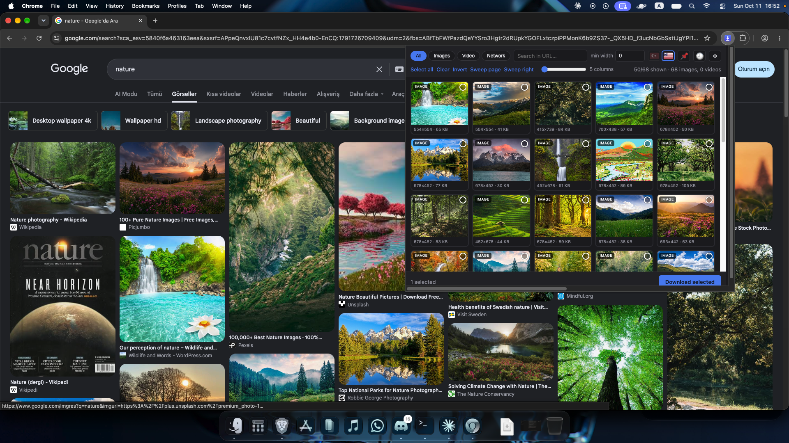
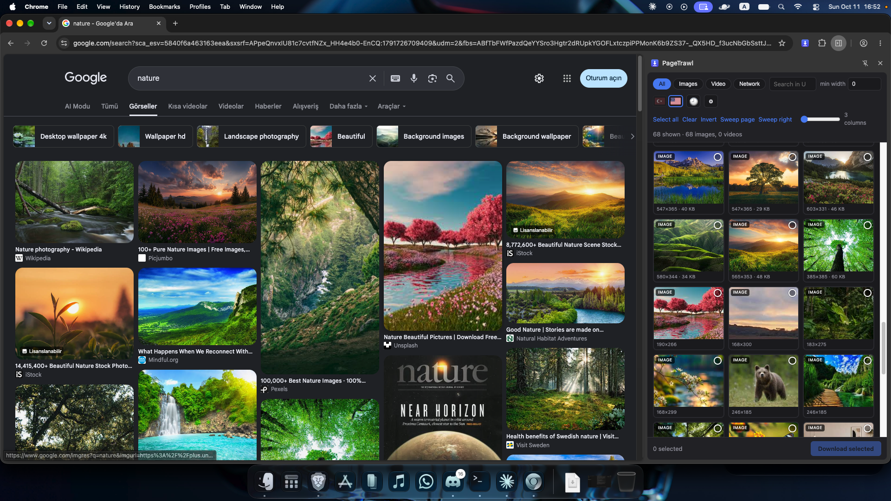

# PageTrawl

Trawl the open page for images and videos, filter them, download in bulk.
A personal-use Chrome extension (Manifest V3, plain JS — no build step), with a
bundled browser video engine and an optional local yt-dlp bridge.

**Popup view** — browse, filter, and select media from the current page.



**Side panel** — keep PageTrawl open while browsing.



## Install

1. Open `chrome://extensions`
2. Turn on **Developer mode** (top right)
3. **Load unpacked** → pick this folder
4. The icon appears in the toolbar; pin it via the puzzle-piece menu

After changing code, hit the reload (⟳) button on `chrome://extensions`. For
`popup.js`/`popup.css` changes you also need to close and reopen the popup.

> **No extra installation for supported video streams.** Select **Browser — no
> installation** (the default), play the video so its stream is detected, then
> select the stream card and download. HLS/DASH support and limits are below.
> The optional yt-dlp method still needs the native bridge; so does automatic
> saving outside the browser's download directory using a custom absolute path.

## Usage

- **Click the icon** → the page is scanned, media found is listed in a grid
- 📌 **opens the same UI in Chrome's side panel, which does not close when you
  click elsewhere.** The action popup closes the moment it loses focus and no API
  can prevent that; the side panel isn't subject to the rule — it stays docked
  next to the page until you close it. The panel follows whichever tab you are
  looking at, and switching tabs does **not** cancel a sweep running on another
  tab. It is the same `popup.html`, opened via `side_panel.default_path` with
  `?panel=1`, laid out for a narrower, resizable column
- The list stays **live** while the popup is open: as you scroll and new
  images/videos load, cards append themselves (flashing a green border for a
  moment). Navigating the tab to another page/video resets and rebuilds the list
  — no need to close and reopen the popup
- Click cards to select; `Select all` / `Invert` for bulk selection
- **Different qualities of the same video collapse into one card.** Two signals
  decide this, and both are *certain* rather than guesses: sources that sit under
  the same `<video>` element (the DOM says they are one video, so the URLs need
  no quality stamp at all — this is what handles hashed CDN paths like
  `…/a3f9c1.mp4?token=…`), and URLs that differ only by an expiring signature.
  Where neither applies the old cautious rule still holds — a quality stamp in
  the URL (`clip_360p.mp4`, `clip_720p.mp4`, `clip_1080p.mp4` → a single card),
  and no stamp means no grouping. The card shows the best quality; the arrow at the bottom right opens the list so you can
  pick a specific one. Clicking the card body selects the best quality, and
  `Select all` takes one file per card — so you don't download the same video
  three times
- **Sweep page** scrolls an infinite-scroll gallery for you, a screen at a time,
  picking up everything that lazy-loads on the way down. It stops on its own
  when the page stops growing and no new media arrives, and puts you back where
  you were when it finishes. Press it again to stop early. **The sweep runs in
  the service worker, so you can close the popup and let it work** — whatever it
  finds is waiting for you in the grid when you open it again
- **Sweep right** presses the right arrow key on the page instead of scrolling —
  for slideshows and lightbox galleries that advance one image at a time. It
  stops once no new media has arrived for a few presses. Note that the page is
  **not** rewound afterwards: we pressed a key rather than scrolling, and
  pressing left the same number of times would assume we know what the site did
  with it. Only one sweep runs at a time; starting one disables the other
- Filters at the top: type (image/video), **network**, URL search, minimum width.
  The `Network` chip filters by *source* rather than type: it shows only media
  captured from network traffic — the JS-fetched files that never appear in the
  page DOM — and includes both images and video. Handy after a sweep, where a lot
  of what turns up arrives that way. The cards themselves carry a `network` tag
- The **slider** sets card size (2–7 columns); your choice is remembered
- The grid renders progressively: first 50 cards, then 50 more as you scroll
- Selections and "downloaded" marks are remembered per tab, even if the popup closes
- **Download selected** → enters the queue, flowing at the concurrency limit from
  settings
- Progress bar in the bottom bar: `Downloading… 12/49`, then a green
  `49 files downloaded` when finished (red if there were errors). If the popup is
  closed, the same number shows as a **badge on the extension icon** — the queue
  keeps working in the background
- **Right-click** any image or video → "Download this media" (single file, fast path)
- 🕘 opens the **download history**, grouped by the page each file came from —
  Chrome's own download list knows the file's source URL but not the page you
  found it on. Click a page heading to reopen it in a new tab, or a file row to
  reveal it in its folder. Searchable, and clearable from the bottom bar. The
  last 500 entries are kept in `storage.local`, so they survive a browser restart
- **Deleting downloaded files.** Tick the checkbox on any history row (or the one
  next to a page heading to take everything from that page) and press
  `Delete selected files`. A confirmation bar appears first — this deletes the
  files **from disk** and cannot be undone. Files under Downloads go through
  `chrome.downloads.removeFile`; files the bridge moved outside Downloads are
  deleted by the bridge, because Chrome's record points at the staging folder
  they no longer live in. Deleted rows stay in the list, struck through, so you
  keep the record of which page they came from
- Two flags in the header switch the interface language between **Turkish and
  English**; the choice is remembered. Chrome's own `chrome.i18n` follows the
  browser language and can't be switched at runtime, so the strings live in
  `i18n.js` instead. The service worker loads the same file via `importScripts`,
  so context menus and bridge errors follow the choice too — the bridge itself
  sends message *keys* rather than sentences

Files are saved as `Downloads/{site-name}/{file-name}.{ext}`.

### Settings

⚙ slides a **full settings screen** over the popup — like opening a new tab,
except it stays inside the popup. Back arrow or Esc returns to the grid.

It holds the save folder, the concurrency limit, the filename template and the
"ask where to save" toggle. Language is switched from the popup's flags.

> The folder picker window still takes focus, and Chrome closes a popup the
> moment it loses focus, so the popup disappears while you pick. The result is
> written to `chrome.storage.session`: reopen the extension and the settings
> screen opens by itself showing what happened. Nothing is lost, you just don't
> see it instantly.

#### Filename template

Default `{host}/{name}.{ext}`. Fields:

| Field | Value |
|---|---|
| `{host}` | site name (`example.com`) |
| `{title}` | page title — falls back to `{host}` when the page has no usable title |
| `{name}` | the file's own name from the URL |
| `{ext}` | extension (guessed when the URL has none) |
| `{date}` | `YYYY-MM-DD` |

A slash creates a subfolder, so `{host}/{title}/{name}.{ext}` groups downloads
per page. Everything is sanitized: characters illegal on Windows/macOS/Linux
become `_`, and each field is capped at 100 characters.

### Save folder

⚙ → **Browse…** picks a **single** folder for both images and videos. It **may
live outside the Downloads folder** (Desktop, `D:\`, wherever). You can also type
or paste a path into the box and press Enter; **Reset** returns to the default.

With the box empty, direct files follow the filename template under Downloads;
optional yt-dlp downloads go to `Downloads/yt-dlp`.

**Browser HLS/DASH downloads always use `Downloads/PageTrawl`.** They do not use
the custom absolute folder or filename template and never require the bridge.
Enable “Ask where to save each file” to choose the final destination in Chrome's
save dialog after merging. This setting is respected by the browser engine.

#### Why this is so convoluted

Chrome extensions **cannot write outside the Downloads folder** through
`chrome.downloads` — absolute paths and `../` are rejected, and that is a fixed
browser rule. The yt-dlp bridge writes files itself, so it isn't bound by that
rule. To keep this a single setting, the bridge is used for both:

| Job | Who does it |
|---|---|
| The folder picker window | Bridge (`pickdir` → tkinter, falling back to PowerShell `FolderBrowserDialog`) |
| Validating a typed path | Bridge (`checkdir`) |
| Writing a yt-dlp video | Bridge (`-P outdir`) |
| Merging/saving a browser stream | Bundled wasm worker + `chrome.downloads`, under `Downloads/PageTrawl` |
| Downloading the image | Chrome (`chrome.downloads`) |
| Moving the image outside Downloads | Bridge (`move`) |

So if the target is **under** Downloads, images land there directly (the bridge
isn't needed at all). If it is **outside**, an image first lands in
`Downloads\pagetrawl-gecici\`, and the moment the download finishes the bridge
moves it to its real destination and removes the empty staging folder. Without
the bridge installed, files stay in that staging folder and the settings panel
shows a red warning — they never disappear silently.

Details:

- **The popup closes when the folder window opens.** Chrome closes a popup that
  loses focus, and that can't be prevented. The result is written to
  `chrome.storage.session`; next time you open the extension the settings screen
  opens by itself and reports "Save folder updated." A keepAlive runs for the
  duration of `dirPending` so the worker doesn't die while the window is open —
  otherwise a selection you took minutes over would vanish silently.
- **Validation does not create folders.** `checkdir` only looks (does the folder
  exist, or if not, does its parent?); the actual `makedirs` happens at download
  or move time. This keeps a mistyped path from littering your disk.
- **Moves never overwrite**: if the name is taken at the destination, it becomes
  `name (1).jpg`. Since a file can stay locked for a moment (Chrome, antivirus),
  the move is retried 4 times.
- **No move happens while "Ask where to save each file" is on** — you're already
  choosing the location.
- The progress counter is based on Chrome's download; the move happens right
  after, separately. So files settle into place a moment after "49 files
  downloaded" appears.
- To change the Downloads root entirely: `chrome://settings/downloads`.

There is no API that returns the absolute path of the Downloads folder. The first
time the settings panel opens, a silent probe download runs to learn and store it
(this is also how the extension decides whether a folder sits under Downloads).
The probe comes from a `data:` URL — the extension's own `chrome-extension://`
resource used to be used, but Chrome refuses to download that through the
`downloads` API and returns `NETWORK_FAILED`.

The probe uses `saveAs: false`. Without stating that explicitly, Chrome's own
"ask where to save each file" setting takes over and the probe opened a Save
dialog **named `download.txt`** (with a `data:` URL Chrome also swallows our
filename suggestion).

## Browser video downloads — no extra installation (v1.29)

The video bar defaults to **Browser — no installation**. Play the video, scan
its page, select an `HLS`/`DASH` stream card (shown as `stream`) and click
**Download selected**. The top Download button uses selected stream cards, or
the only detected stream; with multiple streams it asks you to choose rather
than guessing which one is the video and which one is an advert.

Segments are fetched with browser credentials and merged locally by the bundled
single-thread ffmpeg WebAssembly engine. No Python, Homebrew, native ffmpeg,
yt-dlp, server upload, or runtime CDN script is required. The extension package
includes approximately 32 MB of wasm. Video is remuxed to MP4 without re-encoding;
**Audio only** creates MP3. Best/1080p/720p selects an available representation,
not an upscale or transcode.

Supported:

- Finished, unencrypted HLS media/master playlists, MPEG-TS and fragmented MP4,
  default external audio groups, initialization maps and byte ranges.
- Static, single-period DASH: inherited SegmentTemplate (Number/Time,
  SegmentTimeline), SegmentList and complete BaseURL media files; selected video
  and audio tracks are merged into one file.
- URLs detected by `.m3u8`/`.mpd` or playlist response MIME types.
- Sequential queue, progress, cancel (clears pending jobs too), download history,
  and continued downloads after the popup closes.

Limits are explicit: **256 MiB total downloaded input per job**, **10,000 segments
per track**, **100 queued jobs**. There is no live recording, encrypted HLS
(including AES-128), DRM removal, discontinuity repair, changing initialization
maps, multi-period DASH, subtitles or site-specific signature extraction.
Memory use exceeds input size during merging; the cap is deliberately conservative.
Unsupported codecs/streams fail visibly, never as a successful playlist download.
Site access controls can still reject requests: browser cookies are included but
custom Referer/Authorization headers are not copied. A `blob:` alone is not a
manifest; play the video so its actual network stream can be found.

Files go to **Downloads/PageTrawl**, or Chrome's save dialog if enabled. The Blob
is retained until Chrome confirms the save; only then does the job become done
and the queue advance. Restarting the browser/extension interrupts in-memory
work; it is not a resumable download system.

## Optional yt-dlp bridge

Select **yt-dlp — optional** in the video bar for site-specific extraction,
large videos, or stream layouts the browser engine doesn't support. Selecting
this method is explicit; a failed browser download never silently launches a
native program. Direct MP4/WebM grid downloads continue to use Chrome's normal
download API.

The bridge downloads a page URL or selected manifests, one job at a time, and
can write to a custom absolute folder. When a manifest is sent to yt-dlp, its
page URL is passed as `--referer`. The following setup and dependency instructions
apply only to this optional native method.

### Setup

#### macOS (Apple Silicon and Intel)

PageTrawl runs as a **Google Chrome extension**, not a standalone `.app` or
Safari extension. Load this folder with **Load unpacked** at
`chrome://extensions` with Developer mode enabled, then copy PageTrawl's ID.

```bash
# Install the native bridge dependencies (Homebrew required).
brew install python yt-dlp ffmpeg deno
cd /path/to/pagetrawl
# Replace the example with the 32-character ID shown by Chrome.
bash setup-native.sh YOUR_EXTENSION_ID
```

Reload PageTrawl at `chrome://extensions`. No administrator account is needed.
The installer creates a launcher in `~/Library/Application Support/PageTrawl`
and registers it in Chrome's per-user `NativeMessagingHosts` directory, following
[Chrome's native messaging documentation](https://developer.chrome.com/docs/extensions/develop/concepts/native-messaging).
The launcher uses the selected Python's absolute path. Keep the downloader
folder in place; rerun setup after moving it or replacing Python.

Finder-launched Chrome can find tools in both `/opt/homebrew/bin` (Apple Silicon)
and `/usr/local/bin` (Intel), plus `~/.local/bin`, `~/.deno/bin`, and `~/.bun/bin`.
The folder picker uses macOS's native dialog without requiring Tkinter.
If macOS asks for folder access or System Events automation permission, allow
access for the folder you want to use. Cancelling the picker leaves it unchanged.

To unregister the bridge: `bash setup-native.sh --uninstall`.
This preserves downloads and extension settings. Basic browser downloads work
without the bridge; yt-dlp downloads and moving files outside Chrome's download
folder require it. This installer targets Google Chrome, not other browsers.

Validation: `python3 -m unittest discover -s native -p 'test_*.py' -v`.
For a manual check, open PageTrawl on a media page, check the yt-dlp status,
choose a folder, download a file there, then test cancelling a download.

#### Windows

```powershell
# 1. Load the extension, copy its ID from chrome://extensions
# 2. In this folder:
.\setup-native.ps1 -ExtensionId <32-char-id>
# 3. Reload the extension on chrome://extensions (⟳)
```

The script writes the launcher `.bat`, the host manifest and the registry key
(`HKCU\Software\Google\Chrome\NativeMessagingHosts\com.bozgu.ytdlp`). No admin
rights needed. To remove: `.\setup-native.ps1 -Uninstall`.

The two files it generates (`native/ytdlp_host.bat`,
`native/com.bozgu.ytdlp.json`) are **not** in the repo — they're gitignored,
because they contain absolute machine-specific paths (where Python lives) and the
extension's local ID. Shipping them ready-made wouldn't help anyway: an unpacked
extension gets a different ID on every install, and the bridge silently fails to
connect under the wrong ID. That's why step one is copying the ID.

### Dependencies

| Tool | Required? | Note |
|---|---|---|
| yt-dlp | **Yes** | `pip install -U yt-dlp`. YouTube breaks as it ages — update monthly. |
| JS runtime (node/deno/bun) | **Yes, for YouTube** | yt-dlp deprecated runtime-less extraction. If Node is present the host selects it automatically (`--js-runtimes node`). |
| ffmpeg | Recommended | Without it video+audio can't be merged → ~720p ceiling on YouTube, and "audio only" gives raw m4a instead of mp3. `winget install Gyan.FFmpeg` |

The host looks all three up on every call; if ffmpeg isn't on PATH it also scans
the winget install tree and passes what it finds to yt-dlp via
`--ffmpeg-location`. This prevents ffmpeg from looking "present in the terminal,
missing in the extension" when Chrome was started before PATH was updated.

**Cookies are off by default.** Chrome 127+ encrypts its cookie database with
App-Bound Encryption, and yt-dlp can't decrypt that on Windows
(`Failed to decrypt with DPAPI`). Trying cookies first on every download only
added latency. If you need logged-in content, run yt-dlp manually with
`--cookies` (a cookies.txt exported from the browser).

### Usage

Open the extension on a supported site and a download bar appears above the grid,
with the video's **thumbnail, title and channel name**. Pick a quality, hit
Download — the progress bar streams live. Files go to the ⚙ **save folder**, or
to `Downloads\yt-dlp\` if none is set.

The status line shows a single plain sentence rather than yt-dlp's raw output
(`Downloading… 13%`, `Downloaded`); the raw line and the target folder live in the
tooltip.

On YouTube the title, channel and duration come from the **oEmbed** endpoint
(`youtube.com/oembed`) plus `<video>.duration`. The page's own `og:` and
microformat tags get stuck on the previous video during SPA navigation, so they
reported the wrong title and channel; the thumbnail always looked right because
it's derived from the video ID in the URL, which is exactly what made the bug
confusing. The bar only shows a warning line when something would actually block
a download (no yt-dlp, no JS runtime).

Outside YouTube the cover is looked for in several places and tried **in order**,
because relying on `og:image` alone left the bar showing its grey placeholder on
a lot of sites — the tag is sometimes missing, and sometimes the CDN refuses the
request once it comes from the extension. The order is: the player's own
`<video poster>` (the page has already loaded it, so it is guaranteed to render),
`og:image`, `twitter:image`, `og:image:secure_url`, `thumbnailUrl` out of any
JSON-LD `VideoObject`, then `<link rel="image_src">`. Relative URLs are resolved
against the page. Each candidate that fails to load falls through to the next; if
they all fail the grey ▶ placeholder stays rather than a broken-image icon. The
`` also carries `referrerpolicy="no-referrer"`, since some CDNs reject a
foreign referrer but allow none at all.

The bridge's "are you installed?" answer (`probe`) arrives as its own message
type, not inside the download status. In the version where both rode in the same
object, the field stuck to the status object and the popup treated every live
progress message as a probe reply, so the bar never advanced — it only moved when
the popup was closed and reopened.

> This tool is for personal use. YouTube's and Instagram's terms of service
> prohibit downloading content; DRM-protected services (Netflix and the like) are
> out of scope and technically unsolvable anyway.

## Files

| File | Job |
|---|---|
| `manifest.json` | Permissions and entry points (popup + `side_panel`) |
| `background.js` | Service worker: download queue, context menus, network listener |
| `scanner.js` | DOM scanner injected into the page |
| `popup.html/css/js` | Grid UI, filters, selection |
| `i18n.js` | Turkish/English strings + the `t()` helper; shared by the popup and the service worker |
| `icons/` | Extension icons (16/32/48/128) + `make-icon.py` that generates them (Pillow) |
| `stream/plan.js` | HLS/DASH manifest planning |
| `stream/offscreen.js`, `stream/mux-worker.js` | Browser fetch, local wasm mux and Blob ownership |
| `stream/background.js` | Persistent browser queue, download/history coordination |
| `native/ytdlp_host.py` | Native messaging host: calls yt-dlp, opens the folder window, moves files |
| `setup-native.ps1` | Bridge setup (bat + host manifest + registry) |

## How it works

- Downloads go through `chrome.downloads.download()` — Chrome's own download
  engine. That way **cookies from your profile are sent automatically** (so
  logged-in sites work), CORS isn't an issue, and pause/resume comes for free.
- The queue lives in `chrome.storage.session`. Under MV3 the service worker dies
  when idle, and an in-memory queue would be lost. The `downloads.onChanged`
  event wakes the worker and starts the next file, so the queue flows by itself.
- The scanner collects ``, `srcset` (picking the largest variant),
  `<picture><source>`, CSS `background-image`, `<video>` + `<source>` + poster,
  lazy-load attributes (`data-src` / `data-original`), and `<a href>` links that
  point at media. `allFrames: true` means iframes are scanned too.
- Network traffic is watched via `webRequest.onResponseStarted`, so media that
  never appears in the DOM (fetched by JS) is added to the list tagged "network".
  Under MV3 the observational side of webRequest still works — only the blocking
  side was removed. Captures accumulate under `net:{tabId}`; if the popup is open,
  the background also announces them immediately with a `netAdded` message.
- While a sweep is running, a URL change **within the same host** is treated as
  moving through the gallery rather than as navigation. Slideshows and lightboxes
  push a new URL for every image (`/album/1` → `/album/2`); counting that as
  navigation would wipe the collected list on every step and cancel the sweep
  itself. This applies on both sides: the popup keeps its grid, and the worker
  skips the `tabs.onUpdated` cleanup for the tab being swept — otherwise it was
  clearing the network-capture buffer before its 600 ms debounce had flushed, so
  captures never reached the popup at all. A change of host still resets
  everything and stops the sweep, and when no sweep is running any URL change
  resets as before.
- The live list is fed from two sources: that `netAdded` message, and a poll the
  popup runs every 1.2 s. Scanning the whole DOM on every poll would be expensive
  (the `getComputedStyle` loop especially), so `scanner.js` installs a
  `MutationObserver` on the page and keeps a "did anything change" flag; if the
  flag is clean the scanner returns `{unchanged:true}` immediately. The flag
  survives between calls because it lives in `executeScript`'s isolated world.
  Every eighth round a full scan runs regardless of the flag, to catch what the
  observer misses (such as style-driven backgrounds).
- New items are appended to the **end** of the list and the list is never
  re-sorted, so scroll position, selection and already-rendered cards stay put.
  The list stops at 3000 items (so infinite scroll doesn't lock up the popup).
- The progress counter also lives in `storage.session` and passes through a single
  promise chain; if `_pump` and `onChanged` wrote at the same time,
  read-modify-write updates would be lost. Only downloads the extension started
  are counted (their IDs are recorded), otherwise the user's own downloads would
  pollute the counter.
- The side panel runs the same `popup.html` with `?panel=1`, which only switches
  the layout and turns on tab-following (`tabs.onActivated`). Opening it closes
  the action popup — two live scanners polling the same tab would race over the
  page's "something changed" flag. Because a sweep belongs to a *tab*, the panel
  only shows "Stop" when the running sweep is on the tab currently being viewed,
  and switching tabs never cancels it.
- The download history lives in `storage.local`, not `storage.session`: the queue
  and the counter are "work in flight" and are meant to vanish, but a history that
  disappeared when you closed the browser would be pointless. Entries are opened
  when a download *starts* (that's when Chrome hands us the ID) and marked
  done/failed by `onChanged`; both writes share a promise chain for the same
  reason the counter does. The page a file came from rides along with the queued
  job, because by the time the download starts the popup may be long gone.
- Deleting a file is the only irreversible thing either half of this tool does,
  so the bridge applies three brakes to every path it is handed: the path must be
  absolute, it must sit **under the save folder or Downloads** (the extension
  sends those roots with every request), and it must be a plain file — never a
  directory, and never a symlink, since a link pointing at a folder would pass an
  `isfile` test and take the folder with it. A path that is already gone counts
  as success, so a batch containing a file you deleted by hand doesn't come back
  red. None of these brakes should be loosened for convenience.
- The page sweep runs in the **service worker**, not the popup: the injected
  function performs a single step and reports back, and the worker also runs the
  scan after each step, accumulating what it finds under `swept:{tabId}`. Nothing
  keeps running inside the page itself, and stopping is just a flag. The worker
  is kept alive while sweeping by the same mechanism yt-dlp downloads use. This
  is also what makes the sweep survive the popup closing — and it fixes a
  subtler problem: when the popup ran its own scan in parallel, whichever side
  scanned first cleared the page's "something changed" flag and the other got
  `unchanged`, so slides could go missing. Now the worker is the single scanner
  during a sweep and pushes what it finds to the popup.
- Scrolling down stops when the page is at the bottom,
  has stopped growing and no new media has arrived for five rounds — all three
  together, because on an infinite feed the page grows a moment *after* it hits
  the bottom. Sweeping right has no equivalent notion of "the end", so its only
  signal is whether new media still arrives; it waits seven rounds rather than
  five, because the next slide can take longer than one round to load.
- For files headed outside Downloads, the "which download goes where" mapping is
  in `storage.session` too (`moves`) and passes through the same single chain: the
  worker can die before a download finishes, and move information held in memory
  would be lost.
- While yt-dlp is running (and while the folder window is open) the worker calls
  `runtime.getPlatformInfo()` every 20 s. The result is unused; its only job is to
  reset the idle timer. If the worker dies, the native port closes, the host's
  stdin hits EOF and its main loop ends — the download completes on the host side,
  but no progress arrives and cancelling does nothing.

## Known limitations

- **`blob:` URLs cannot be downloaded directly** — use a detected HLS/DASH
  stream card, or the optional yt-dlp method for site-specific extraction. The `blob:` URL you see in a `<video>` tag is a reference living in
  the page's memory; it isn't reachable from the extension's context. The popup
  counts such videos and shows a warning.
- **DRM-protected content (Widevine)** arrives encrypted and is technically
  unsolvable. Since v1.28 such videos are at least *detected* — via the media
  element's `mediaKeys` and the `encrypted` event — and shown in the grid as
  **locked cards**: greyed out, marked with a lock and a `DRM` tag, with no
  checkbox. They cannot be selected, so "Select all" skips them and they can
  never reach the download queue. They also get their own notice line, separate
  from ordinary `blob:` videos, and they no longer open the yt-dlp bar. Listing
  something undownloadable is deliberate: the question a user actually has is
  "why can't I get this video?", and silence leaves them blaming their own setup.
- **Thumbnails may not render.** Sites with hotlink protection reject requests
  coming from the extension context, so you see a file-extension label instead of
  a preview. The file itself can still download, because that goes through
  `chrome.downloads` with your cookies.
- **`chrome://`, the Web Store and the PDF viewer can't be scanned** — Chrome
  blocks extension injection there.
- **Files saved under a folder you have since changed away from can't be deleted
  from the history.** The bridge only deletes below the *current* save folder or
  Downloads, and it has no way to know a folder you used last month was once
  legitimate. You get a message saying the file is outside the save folder;
  delete it by hand.
- **`Sweep right` only works on sites that handle the arrow key in JavaScript.**
  The key event it sends is synthetic (`isTrusted: false`), so it wakes up a
  site's own `keydown` listener — which is how slideshows and lightboxes work —
  but it does **not** trigger the browser's built-in behaviour. A plain
  horizontally-scrolling container that relies on the browser to move it will not
  budge. Sending trusted input would require the `debugger` permission and the
  banner that comes with it, which is far too invasive for this tool.
- **The action popup still closes when it loses focus** — that is Chrome's fixed
  rule and there is no API to opt out. 📌 works around it by moving the UI into
  the side panel; it does not fix the popup itself. This is also why picking a
  save folder closes the popup (use the side panel and that annoyance goes away).
- **Nothing an extension can do floats above other applications.** The side panel
  is docked inside the browser window, not always-on-top over your desktop —
  Chrome has no API for that since the old Chrome Apps `alwaysOnTop` was removed.
- **The page sweep only scrolls the main frame.** Media inside an iframe is
  still scanned, but scrolling something the user can't see would be the wrong
  behaviour. The sweep itself survives the popup closing, but not the service
  worker being killed by the browser; if that happens the state goes stale after
  15 seconds and the buttons unlock again.
- **On very large pages some CSS background images may be missed.** The
  `getComputedStyle` sweep is split into chunks and run through
  `requestIdleCallback`, but a single scan round is capped at 3 seconds; if it
  runs out, the popup says so rather than staying silent about it.

## Next steps (optional)

- Referer header injection: a `declarativeNetRequest` `modifyHeaders` rule for
  hotlink-protected sites (MV3 requires this instead of blocking `webRequest`)
- Playlist support in the yt-dlp bar (dropping the `--no-playlist` flag)
- Firefox support — the `browser.*` APIs are largely the same, but the native
  messaging manifest location and registry differ

## Scope and responsibility

This tool was written for **personal use**. The terms of service of services like
YouTube and Instagram prohibit downloading content; what you download and its
copyright status are your responsibility. DRM-protected content (Widevine) is out
of scope — it arrives encrypted, is technically unsolvable, and the tool has no
such capability.

## Verification

```bash
node --test tests/stream-plan.test.cjs
python3 -m unittest discover -s native -p 'test_*.py' -v
# Developer-only: requires Playwright with Chromium and native ffmpeg/ffprobe
# to generate synthetic test videos. None are runtime requirements.
node tests/browser-stream.cjs
```

The browser integration test generates its own short videos, uses a disposable
Chromium profile and a local HTTP server, then verifies saved audio/video tracks
and duration with ffprobe. It tests queueing, cancel, errors and popup closure.

## License

PageTrawl source: MIT — see [LICENSE](LICENSE). The bundled ffmpeg core is
GPL-2.0-or-later; see [its notices and source links](vendor/ffmpeg/README.md).
